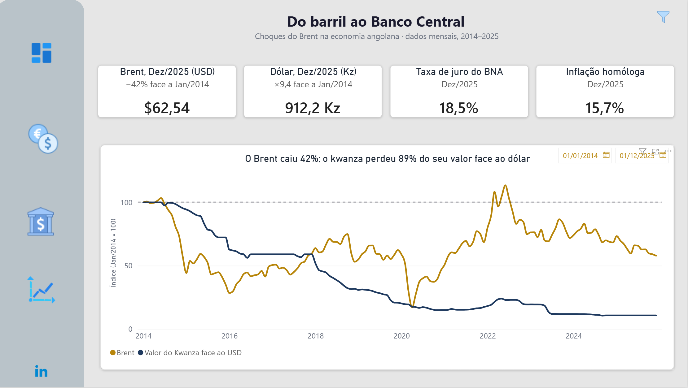
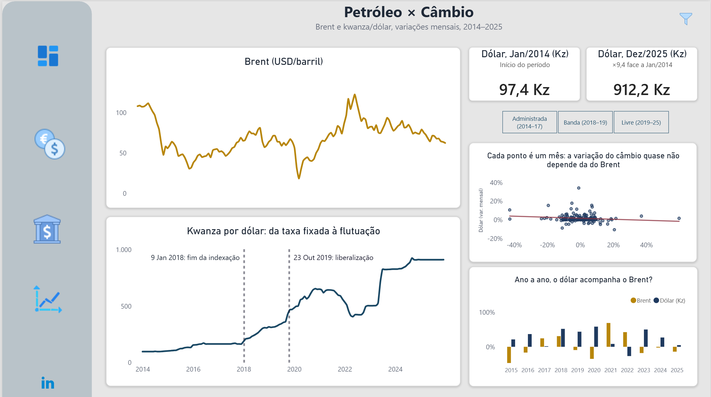
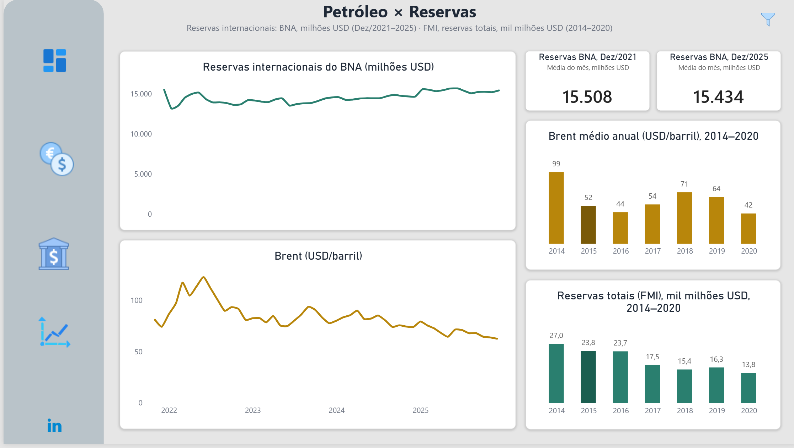
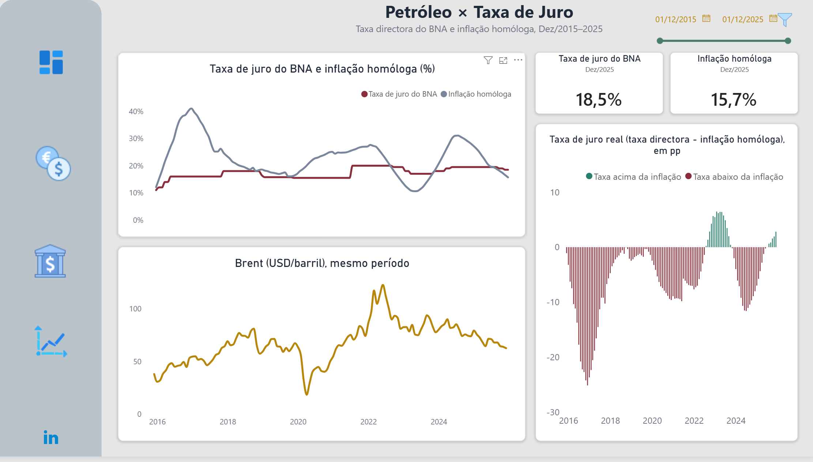

# Do Barril ao Banco Central: Choques do Brent na Economia Angolana (2014–2025)

Análise de dados reais (2014–2025) sobre a ligação entre o preço do petróleo Brent e três variáveis da economia angolana: o câmbio, as reservas internacionais e a taxa de juro do BNA.

**Ferramentas:** Excel / Power Query → SQL Server → Power BI

**Resumo executivo:** [RESUMO_EXECUTIVO.md](RESUMO_EXECUTIVO.md) · **Metodologia:** [metodologia_projecto.md](metodologia_projecto.md)

**Dashboard interactivo:** [Power BI](https://app.powerbi.com/view?r=eyJrIjoiMmQzZmQ5OWItNWIxOC00N2Y2LThmZGYtZjUzYTQ3NjZiNWM0IiwidCI6IjgyNWI5NmI2LTdhMDAtNDI4Ny05ZmRhLWQ4MWM4ZTJkZmNhYiJ9)

## A pergunta

Angola vive das exportações de petróleo e importa grande parte do que consome. O preço do Brent condiciona, por isso, as receitas em divisas, e seria de esperar que se reflectisse no câmbio, nas reservas e na política monetária. O projecto procura essa ligação nos dados mensais de 2014 a 2025.

## O que os dados mostram

### 1. Câmbio: sem relação mês a mês, com coincidências ao nível anual
- Entre Janeiro de 2014 e Dezembro de 2025, o Brent caiu 42% (de 108 para 62,5 USD), e o dólar passou de cerca de 97 para cerca de 912 Kz (×9,4). Em termos nominais, o kwanza perdeu 89% do seu valor face ao dólar.
- O regime cambial marca o ritmo. Até 9 de Janeiro de 2018, a taxa era fixada directamente pelo BNA, indexada ao dólar, e esteve fixa em 166 Kz/USD desde o 1.º trimestre de 2016. Depois passou a flutuar dentro de uma banda, com leilões de divisas, e foi liberalizada em Outubro de 2019. A série mostra um patamar plano em 2016–2017 e degraus depois.
- Mês a mês, não há relação consistente entre o Brent e o câmbio, nem sequer no período livre (desde Novembro de 2019), em que a taxa oficial já reflecte o mercado. No período administrado, a taxa oficial não mede o choque: esteve fixa durante 2016–2017 e só se ajustou depois, por degraus.
- Ao nível anual há coincidências: em 2014–2016, o Brent a cair, as reservas a cair e o câmbio a ajustar-se; em 2021–2022, com o Brent a subir, o kwanza apreciou-se (página 2 do dashboard).

### 2. Reservas: caíram com o choque de 2014–2016 e estabilizaram desde 2021
- Entre 2014 e 2020, as reservas totais (FMI) caíram de cerca de 27,0 para cerca de 13,8 mil milhões USD (−49%), com o Brent a passar, em média anual, de 99 para 42 USD.
- Em 2015, as reservas em USD caíram 12% e o indicador em meses de importações subiu (de 5,2 para 6,5), o que implica que as importações caíram mais depressa (cerca de −30%).
- Desde Dezembro de 2021, as reservas do BNA estabilizaram em torno de 15 mil milhões USD (15.508 M USD e 15.434 M USD), enquanto o Brent oscilou entre cerca de 120 e 60 USD. A série do FMI, em níveis mais baixos, mostra também uma variação pequena (−6%): 14,5 mil milhões em 2021 e 13,5 em 2025.
- As fontes têm definições e unidades diferentes (FMI, em dólares e em meses de importações; BNA, em milhões de dólares), por isso não se juntam numa só série.

### 3. Taxa de juro: acompanha a inflação, mas fica abaixo dela
- A taxa directora do BNA variou entre 8,75% (Julho de 2014) e 20% (2021–2022), e fechou 2025 em 18,5%. A inflação homóloga chegou a 41,1% e fechou 2025 em 15,7%.
- Em 100 dos 121 meses com inflação disponível (a partir de Dezembro de 2015), a taxa directora esteve abaixo da inflação, ou seja, a taxa de juro real foi negativa na maior parte do período, com o ponto mais baixo em 2016 (−25,1 pontos percentuais).
- Nos dois episódios de subida forte da inflação (2015–16 e 2023–24), a taxa subiu, mas sempre muito menos do que os preços. Entre Maio de 2016 e Novembro de 2017 esteve parada em 16%, apesar da inflação elevada.
- Correlações das variações mensais, calculadas em SQL (secção 8.3 de `sql/analise_economia_angola.sql`): associação fraca com a inflação e nenhuma com o Brent.

### Síntese
Nos dados mensais, o Brent não aparece directamente ligado ao câmbio nem às reservas, e a taxa de juro responde mais à inflação interna do que ao petróleo. Ao nível anual, porém, o choque de 2014–2016 é seguido de uma queda das reservas que, até 2020, chegou a metade, e de ajustamentos cambiais por degraus. Isto sugere uma transmissão diferida, mediada pelo regime cambial e pelas reservas, em vez de contínua e mensal. É uma leitura, não uma prova: os dados não separam o efeito do petróleo do de outros factores (a produção, por exemplo, também caiu no período).

## Dashboard

| | |
|---|---|
|  |  |
|  |  |

## Dados e fontes

| Variável | Fonte | Frequência | Período | Notas |
|---|---|---|---|---|
| Brent (USD/barril) | EIA, série RBRTE | mensal | 2014–2025 | |
| Câmbio AOA/USD | BNA (ficheiro Excel) | diário, agregado em média mensal | 2014–2025 | |
| Inflação (IPC nacional, variação homóloga) | INE | mensal | série desde Dez/2014 | a variação homóloga só existe a partir de Dez/2015 |
| Reservas, parte A (USD e meses de importações) | FMI, International Financial Statistics (via Banco Mundial): *Total reserves (includes gold, current US$)* e *Total reserves in months of imports* | anual | 2014–2020 | |
| Reservas líquidas em meses de importações (complementar) | FMI, via FRED: *Net Reserves by Months of Imported Goods and Services* (AGOBRASSMIMH) | anual | 2014–2020 | está na base de dados, mas não no dashboard; valor repetido nos 12 meses de cada ano |
| Reservas, parte B | BNA (reservas internacionais, milhões USD) | diário, agregado em média mensal | Dez/2021–2025 | |
| Taxa de juro directora | BNA (decisões do Comité de Política Monetária) | por decisão, estendida a mensal | 2014–2025 | cada mês usa o último valor em vigor |

## Limitações

- Correlação não é causalidade, e a análise mensal é linear. As coincidências ao nível anual assentam em poucos pontos (11 anos).
- A receita em divisas depende do preço e do volume, e a produção caiu de cerca de 1,7–1,8 milhões de barris/dia (2015) para cerca de 1,1 (desde 2021). Usar só o Brent omite metade do choque.
- Em 2016–2017 o câmbio oficial esteve quase constante, pelo que a amostra efectiva do regime administrado é de cerca de 24 meses.
- As reservas têm fontes com definições e níveis diferentes (em 2025, 13,5 mil milhões USD no FMI contra 15,4 no BNA), e o BNA só tem dados mensais a partir de Dezembro de 2021.
- A inflação homóloga só começa em Dezembro de 2015, e a taxa de juro muda por degraus, com poucas decisões em 12 anos.
- A queda das importações em 2015 é uma implicação aritmética das séries do FMI, não foi medida com dados directos de importações.

## Próximos passos

1. Juntar a receita petrolífera do Orçamento Geral do Estado e o volume exportado, para testar a transmissão através do orçamento.
2. Passar das correlações a pares a um modelo multivariado (estacionariedade, causalidade de Granger e um VAR com Brent, câmbio, reservas e inflação), numa versão 2 em Python.
3. Medir o câmbio de mercado (paralelo) no período administrado, se houver série disponível.

## Como foi feito

- **Excel / Power Query:** recolha e limpeza (API da EIA em JSON, agregação do câmbio e das reservas de diário para mensal, extensão da taxa de juro de decisões para meses).
- **SQL Server:** base `EconomiaAngola`, com `Dim_Calendario` (144 meses) e `Facto_Indicadores_Economicos` (uma linha por mês). As relações foram medidas sobre variações mensais, em SQL.
- **Power BI:** dashboard de 4 páginas (Resumo Executivo, Petróleo × Câmbio, Petróleo × Reservas, Petróleo × Taxa de Juro), com um filtro por regime cambial na página 2. As medidas DAX estão documentadas em [`medidas_dax.md`](medidas_dax.md).

A parte estatística (testes, desfasamentos, limiares, registo de correcções e origem de cada número) está no [documento de metodologia](metodologia_projecto.md).

## Estrutura do repositório

```
├── README.md
├── RESUMO_EXECUTIVO.md
├── metodologia_projecto.md
├── medidas_dax.md          medidas e colunas calculadas do dashboard (DAX), com valores de controlo
├── sql/                    scripts SQL (esquema, calendário, importação e análises)
├── imagens/                capturas do dashboard
└── dados/
    ├── indicadores_mensais.csv    tabela mensal final (entrada do script SQL)
    └── reservas_fmi_anual.csv     reservas totais do FMI, anuais (2014–2025)
```

Os dados pertencem às fontes indicadas acima. O repositório inclui apenas a tabela mensal final (144 linhas, de Janeiro de 2014 a Dezembro de 2025), que é a entrada do script SQL, e a série anual das reservas totais do FMI, para permitir reproduzir a análise (separador `;`, decimais com vírgula). O dashboard está publicado no Power BI (ligação no topo).

## Competências demonstradas

Modelação de dados · SQL Server (CTEs, funções de janela, `LAG`, `GROUPING SETS`) · Power Query · Power BI e DAX · Análise de séries temporais macroeconómicas · Pensamento crítico (formulação e descarte de hipóteses, registo de correcções)

---

**Autora:** Juliana Sacramento · [LinkedIn](https://www.linkedin.com/in/juliana-sacramento-dados/)
